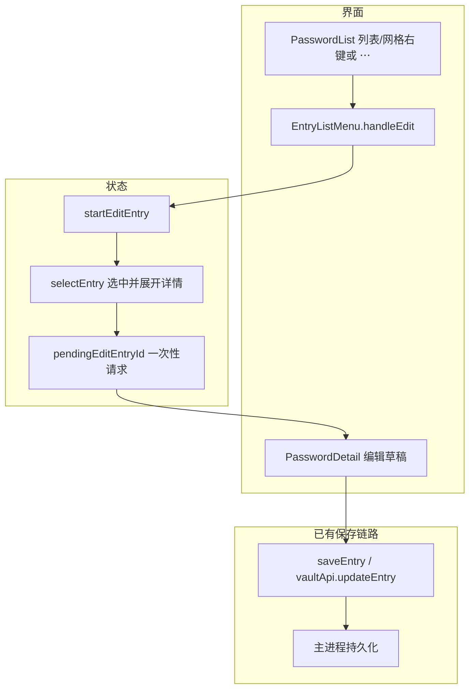

# 条目菜单编辑（v1.48.0）

触发词：条目编辑，右键编辑，菜单编辑，EntryListMenu，startEditEntry，pendingEditEntryId，PasswordDetail。

> 渲染层入口见 [renderer-ui](../code-map/renderer-ui.md)，验证结果见 [v1.48.0 自测报告](../testing/v1.48.0-self-check.md)。本篇合并单仓功能链路与实现说明，无跨服务契约。

| 仓库/服务 | 角色 |
|---|---|
| pwd-book 渲染进程 | 菜单、选中状态、详情草稿、编辑模式 |
| pwd-book 主进程 | 复用已有条目更新和独立详情窗口关闭接口 |

## 1. 整体架构

## 2. 应用范围与交互

适用于主窗口的列表与网格布局，右键和「⋯」三个菜单挂载点共用 `EntryListMenu`。新增「编辑」位于「创建副本」之前，文案复用 `common.edit`，支持中英文。

点击编辑先缓存条目 ID 并发出 `action` 关闭菜单，再调用 `startEditEntry(id)`。若目标已经不存在，则不改变选中状态；若独立详情已打开，则复用新建条目的处理方式关闭独立详情并返回主窗口。`selectEntry` 退出创建状态、选中目标、展开详情并记录活动。

详情原有 watcher 会在切换条目时重置草稿和编辑状态。因此编辑请求通过 `pendingEditEntryId` 交给 `flush: 'post'` watcher，在草稿重置后调用 `startEditing` 并清空请求。普通选择会清空未消费的请求，独立详情组件不会消费主窗口请求。

保存继续使用 `handleSave → saveEntry`，成功后返回只读；取消恢复原条目草稿并隐藏密码/TOTP 密钥。已处于当前条目编辑状态时再次点击菜单编辑不重置草稿。

## 3. 数据字段

| 字段 | 类型 | 说明 |
|---|---|---|
| entry.id | string | 菜单操作的目标 ID |
| selectedEntryId | Ref&lt;string \| null&gt; | 当前选中的条目 |
| pendingEditEntryId | Ref&lt;string \| null&gt; | 待消费的主窗口编辑请求，不持久化 |
| isCreating | Ref&lt;boolean&gt; | 菜单编辑时退出创建模式 |
| detailCollapsed | Ref&lt;boolean&gt; | 菜单编辑时展开，沿用现有本机偏好持久化 |
| detachedDetailOpen | Ref&lt;boolean&gt; | 独立详情已打开时关闭并切回主窗口 |
| isEditing / draft | 组件内 Ref | 沿用详情编辑状态与表单草稿 |

## 4. 代码路径与改动入口

| 用途/需求 | 路径 | 符号 |
|---|---|---|
| 调整菜单项位置与点击行为 | src/components/EntryListMenu.vue | handleEdit |
| 列表、网格和右键入口 | src/components/PasswordList.vue | EntryListMenu 的三个挂载点 |
| 编辑目标与窗口状态 | src/composables/useAppState.ts | startEditEntry / selectEntry |
| 编辑模式与草稿重置时序 | src/components/PasswordDetail.vue | pendingEditEntryId watcher / startEditing |
| 回归测试 | src/components/entryMenuEdit.test.ts | entry menu edit flow |
| Vue 组件测试编译 | vitest.config.ts | Vue 插件编译客户端 render 函数 |

## 5. 调试与验证

1. 使用 Node.js 20 或更新版本运行 `npm test -- src/components/entryMenuEdit.test.ts`。
2. 在 `handleEdit`、`startEditEntry` 和详情编辑请求 watcher 设置断点，确认 ID 始终属于菜单目标。
3. 切换另一条目时，确认先执行 `resetDraftFromEntry`，再执行 `startEditing`，请求最终为 `null`。
4. 列表与网格分别测试右键及「⋯」入口，确认菜单关闭、目标高亮、保存/取消按钮可见。
5. 取消后再次进入编辑、保存到正确 ID、详情收起、独立详情返回主窗口均有自动组件集成回归。

测试通过 Vue 自定义渲染器挂载真实菜单/列表/详情组件，使用内存条目与模拟 API；不访问真实保险库。宿主 UI 与 IPC 被模拟，因此这些测试不验证 Electron 原生窗口实际关闭或屏幕像素布局。

## 6. 相关文档

| 文档 | 用途 |
|---|---|
| [README](../../README.md) | 用户操作和版本摘要 |
| [CHANGELOG](../../CHANGELOG.md) | 1.48.0 更新记录 |
| [renderer-ui](../code-map/renderer-ui.md) | 渲染层组件导航 |
| [自测报告](../testing/v1.48.0-self-check.md) | 影响范围与执行结果 |
